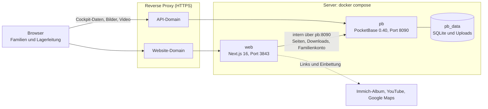

# fit&fun Website

Website des fit&fun Familienlagers in Brigels (nur auf Einladung). Hauptzweck: Familien kommen schnell an die Lagerdokumente. Die Lagerleitung pflegt alles im Cockpit unter `/admin`.

## Aufbau



Für Familien gehen geschützte Inhalte immer über `web` (Lagerpasswort-Cookie), nie direkt aus der API. Inhalte und Uploads liegen nur in `pb_data` (`PB_DATA_DIR`), nie im Repository.

## Cockpit

| Bereich | Inhalt |
|---|---|
| Übersicht | Entwurf und aktives Lager im Fokus, fehlende Angaben |
| Lager | Entwurf → veröffentlicht → archiviert; Dokumente, Texte, Album, Video. Nur ein Lager ist veröffentlicht, Veröffentlichen archiviert das bisherige. |
| Website | Startseite, zwei Akzentfarben (Kontrast wird geprüft) |
| Inhaltsseiten | Kontakt (Text, Personen, Gruppen), Nützliche Links, Lagerhaus |
| Konto | Admin-Passwort, Lagerpasswort |

## Was schützt das Lagerpasswort?

- Geschützt sind Dokumente, Fotoalbum sowie markierte E-Mail-Adressen und Telefonnummern. Neue Dokumente und Kontakte sind standardmässig geschützt.
- Die Freischaltung gilt 400 Tage pro Gerät; jeder geschützte Download verlängert sie. Ein **neues** Lagerpasswort meldet alle Geräte ab, dasselbe erneut speichern nicht.
- Geschütztes liest nur der Server über ein internes Konto (`FAMILY_ACCESS_SECRET`, bekommen Familien nie). Die PocketBase-API gibt es ohne Anmeldung nicht heraus.
- «Link kopieren» (`/api/download/…`) bleibt bei neuen Fassungen gültig, nicht aber bei gewechselter Sichtbarkeit oder gelöschtem Dokument. Ohne Zugang führt er zur Passwortabfrage und danach direkt zur Datei.
- Gegen Durchprobieren: höchstens 10 Fehlversuche pro IP und 50 insgesamt pro Stunde.

## Installation

1. `.env.example` → `.env`; `FAMILY_ACCESS_SECRET` und `REVALIDATE_SECRET` mit `openssl rand -base64 48` erzeugen.
2. `docker compose up -d --build`. Migrationen laufen bei jedem Start; der erste Start übernimmt die Jimdo-Dokumente 2011–2026 (≈ 60 MB).
3. Mit `ADMIN_EMAIL`/`ADMIN_PASSWORD` anmelden; das Cockpit verlangt sofort ein eigenes Passwort.
4. Unter Konto das Lagerpasswort setzen, vorher bleibt Geschütztes zu.

Hinter einem Proxy `NEXT_PUBLIC_PB_URL` (wird beim Build eingebacken), `SITE_URL` und `PB_ORIGINS` auf HTTPS setzen, Upload-Limit ≥ 60 MB, Client-IP als `X-Real-IP` weitergeben.

## Deploy

```sh
set -a; . ./.env; set +a                     # PB_DATA_DIR, REVALIDATE_SECRET laden
git pull && docker compose build --pull      # bauen, solange alles noch läuft
docker compose stop pb && cp -a "${PB_DATA_DIR:-./pb_data}" \
  "<backups>/pre-$(git rev-parse --short HEAD)-$(date -u +%Y%m%dT%H%M%SZ)"
docker compose up -d
curl -X POST localhost:3843/api/revalidate -H 'content-type: application/json' \
  -d "{\"secret\":\"$REVALIDATE_SECRET\",\"path\":\"/\"}"
```

Das Backup ist Pflicht: Migrationen laufen beim Start von `pb` und lassen sich nicht zurücknehmen. Wiederherstellen: `pb` stoppen, Ordner zurückkopieren, starten. Ohne Revalidate zeigen Seiten bis zu 5 Minuten alte oder leere Daten (beim Build läuft PocketBase nicht).

## Wenn etwas nicht stimmt

| Symptom | Ursache und Lösung |
|---|---|
| Familien müssen das Passwort neu eingeben | Lagerpasswort wurde geändert. |
| Link aus einer Mail: «Nicht gefunden» | Dokument gelöscht oder Sichtbarkeit gewechselt: Link neu kopieren. |
| Speichern im Cockpit scheitert | Sitzung abgelaufen: neu anmelden. |
| `/_/` will einen Superuser anlegen | Es gibt bewusst keinen; die Einrichtung braucht einen Token aus den Logs. Nur im Notfall anlegen. |

**Admin-Passwort vergessen:** `docker compose exec pb /pb/pocketbase superuser upsert notfall@example.ch '<temporär>'`, in `http://<host>:8090/_/` unter *users* ein temporäres Passwort setzen und `muss_passwort_aendern` einschalten (Stellvertretung: neuer Datensatz, `rolle` = editor, `verified`). Danach `superuser delete notfall@example.ch`.

## Entwicklung

```sh
FAMILY_ACCESS_SECRET=dev-… ADMIN_EMAIL=… ADMIN_PASSWORD=… pocketbase serve --migrationsDir=pb/pb_migrations
NEXT_PUBLIC_PB_URL=http://127.0.0.1:8090 SITE_URL=http://localhost:3000 REVALIDATE_SECRET=dev FAMILY_ACCESS_SECRET=dev-… npm run dev
```

- Vor jedem Commit: `npm run typecheck`, `npm run lint`, `npm test`.
- GitHub Actions (`.github/workflows/ci.yml`) prüft jeden Push auf `main`, jeden Pull Request und montags den Stand: Typecheck, Lint, Tests, `npm audit --omit=dev`, `next build`. Erst deployen, wenn CI grün ist.
- Dazu ein Browser-Test des Speicherschutzes gegen das echte Next.js (`scripts/e2e-schutz.mjs`, Testseiten `*.e2e.tsx` nur mit `E2E=1`). Lokal: `E2E=1 npm run build && E2E=1 npx next start -p 3100 &` und dann `node scripts/e2e-schutz.mjs http://localhost:3100`.
- Schemaänderungen nur als **neue** Migration mit der nächsten Nummer; bestehende nie ändern (sie sind auf dem Server gelaufen), vorhandene Inhalte nie überschreiben.
- Diese Next.js-Version weicht von älteren ab: vorher `node_modules/next/dist/docs/` lesen.

## Wartung

- Dependabot (`.github/dependabot.yml`) öffnet wöchentlich Pull Requests für npm-Pakete und monatlich für die Actions; neue Versionen erst nach 7 Tagen. Mergen, wenn CI grün ist, dann mit `--pull` deployen. Zurückgestellt, bis Next.js sie unterstützt: TypeScript 7, ESLint 10 (in Dependabot ausgeschlossen).
- `npm audit --omit=dev` muss 0 zeigen; Meldungen nur in Entwicklungswerkzeugen betreffen die Website nicht.
- PocketBase: `PB_VERSION` in `pb/Dockerfile` anheben. Laut Upstream ist 0.40.6 die letzte Version auf GitHub; für neuere die Download-URL anpassen.
