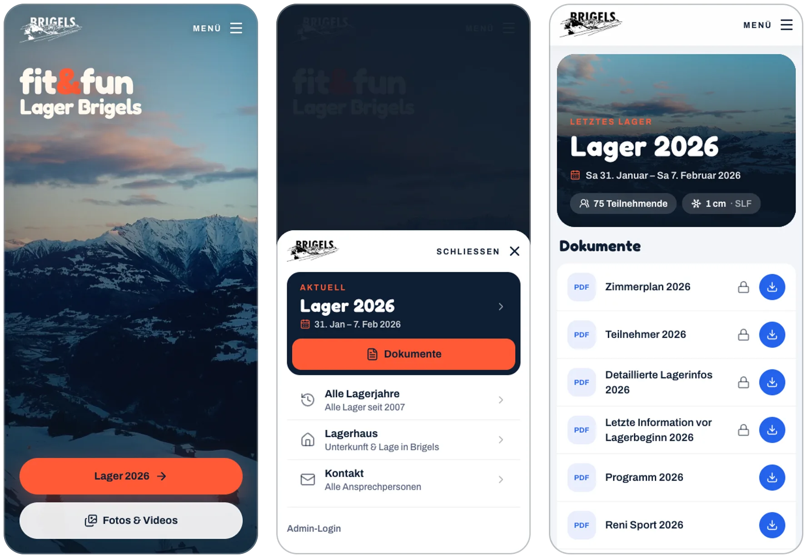
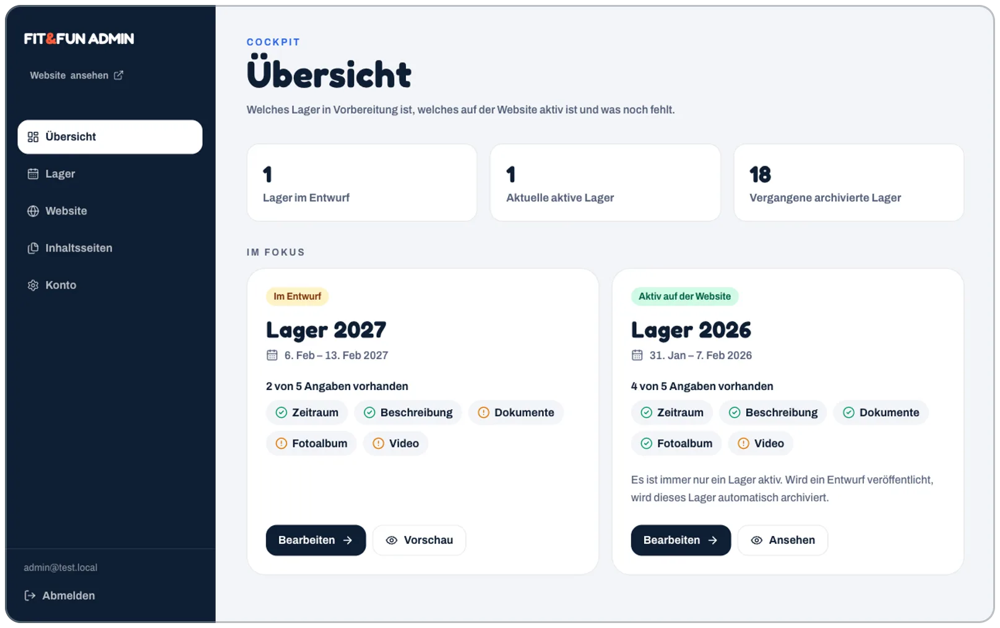
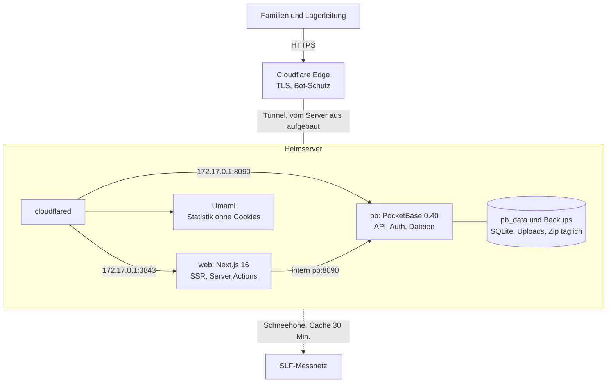
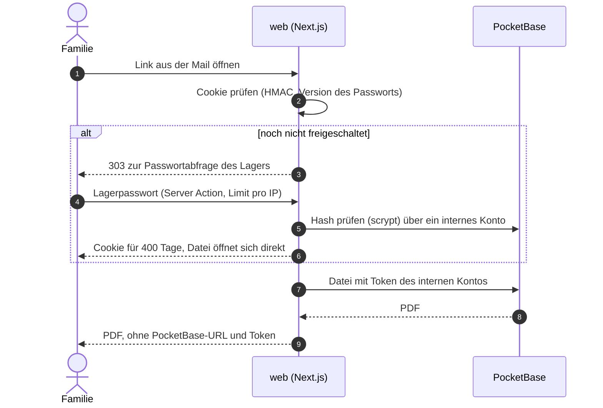

<div align="center">


# fit&fun Website

**Dokumente, Infos und Fotos für ein Familien-Skilager in Brigels.**<br>
Gepflegt von einer Lagerleitung ohne Technikkenntnisse, betrieben auf einem Heimserver hinter einem Cloudflare Tunnel.

[](https://github.com/marcstae/fitundfun-webseite/actions/workflows/ci.yml)


[**Live ansehen**](https://fitundfun.marcstaeuble.ch) · [Funktionen](#-funktionen) · [Architektur](#-architektur) · [DevOps](#-devops) · [Betrieb](#-betrieb)



</div>

Die Website ersetzt eine Jimdo-Seite. Über 100 Dokumente seit 2011 hat eine Datenmigration übernommen. Rund 80 % der Aufrufe kommen vom Handy, darum ist alles mobile-first gebaut: Die Dokumente des aktuellen Lagers sind zwei Fingertipps entfernt.

## ✨ Funktionen

| 👨‍👩‍👧 Für Familien | 🛠️ Für die Lagerleitung (Cockpit) |
|---|---|
| **Dokumente zuerst:** alle PDFs des Lagers auf einer Seite, mit einem Tipp geöffnet | **Übersicht:** Entwurf und aktives Lager im Fokus, fehlende Angaben auf einen Blick |
| **Lagerpasswort einmal pro Gerät:** schaltet geschützte Dokumente, Fotoalbum und Kontaktangaben für 400 Tage frei | **Lager-Lebenszyklus:** Entwurf → veröffentlicht → archiviert; die Datenbank erlaubt nur ein aktives Lager |
| **Links aus Mails bleiben gültig,** auch nach einer neuen Fassung; ohne Passwort erst zur Abfrage, dann direkt zur Datei | **Dokumente:** hochladen, neue Fassung ersetzen, sortieren, Link für Mails kopieren; neue Dokumente sind standardmässig geschützt |
| **Live-Schneehöhe** vom SLF-Messnetz und Countdown «Noch 86-mal schlafen» | **Inhaltsseiten:** Kontakte mit eigenen Gruppen und Sichtbarkeit pro Telefon und E-Mail, Lagerhaus, nützliche Links |
| **Kontakt mit Anruf-Links** (E.164), die Pistenrettung immer sichtbar | **Design ohne Code:** Startbild, Video und zwei Akzentfarben mit WCAG-Kontrastprüfung (≥ 4.5:1) |
| **Lagerhaus, Fotos und Video:** Route in Google Maps, Immich-Album, YouTube ohne Cookies | **Nichts geht verloren:** Backups mit Zeitplan, Download und Wiederherstellung; Rückfrage bei ungespeicherten Änderungen, auch beim Zurück-Knopf |

<p align="center"></p>

## 🧱 Architektur



Geschütztes verlässt PocketBase nie direkt Richtung Familien: `web` prüft das Lagerpasswort-Cookie und reicht Dateien selbst durch.



## 🔄 DevOps

| Praxis | Umsetzung | Wo |
|---|---|---|
| Continuous Integration | Typecheck, Lint, Unit-Tests, `npm audit` der Laufzeitpakete, Build und ein Browser-Test gegen das echte Next.js (headless Chrome über DevTools, ohne Test-Framework). Actions auf Commit-SHA gepinnt, nur Leserechte, zusätzlich jeden Montag. | [`ci.yml`](.github/workflows/ci.yml) |
| Abhängigkeiten | Dependabot wöchentlich für npm (gruppiert) und monatlich für Actions, neue Versionen erst nach 7 Tagen. Majors, die Next.js noch nicht trägt, bewusst ausgeschlossen. | [`dependabot.yml`](.github/dependabot.yml) |
| Container | Multi-Stage-Build mit `output: standalone`, Prozesse ohne Root-Rechte, Healthchecks, Log-Rotation (3 × 50 MB). | [`Dockerfile`](Dockerfile), [`pb/Dockerfile`](pb/Dockerfile) |
| Netzwerk | Ports nur an `127.0.0.1` und die Docker-Bridge gebunden, öffentlich nur über den Cloudflare Tunnel. Die Client-IP fürs Rate-Limit kommt aus `CF-Connecting-IP`. | [`docker-compose.yml`](docker-compose.yml) |
| Schema als Code | Über 30 PocketBase-Migrationen in JavaScript, nur angehängt, nie geändert; darunter die Übernahme von Jimdo. | [`pb/pb_migrations`](pb/pb_migrations) |
| Sicherheit | Zugriffsregeln pro Sammlung, Prüfung des Lagerpassworts über einen scrypt-Hash, signiertes Cookie, Limit von 10 Fehlversuchen pro IP und 50 insgesamt pro Stunde, Sicherheits-Header inklusive CSP. | [`family-access.ts`](src/lib/family-access.ts), [`next.config.mjs`](next.config.mjs) |
| Backup und Wiederherstellung | PocketBase sichert im laufenden Betrieb (`VACUUM INTO`, kein Stopp) täglich um 03:00 Schweizer Zeit in einen eigenen Ordner. Zeitplan, Download, Upload und Wiederherstellung im Cockpit über eigene Hooks mit der Cockpit-Regel statt eines Superusers; vorher entsteht ein Sicherheitsbackup. Eine neue `.env` gleicht der Start-Hook ab. | [`backup.pb.js`](pb/pb_hooks/backup.pb.js), [`backup-verwaltung.tsx`](src/components/admin/backup-verwaltung.tsx) |
| Betrieb | Deploy nach grüner CI von Hand: bauen, Backup, starten, Cache neu aufbauen. Besucherstatistik selbst gehostet mit Umami, ohne Cookies und ohne Cockpit. | [Betrieb](#-betrieb), [`layout.tsx`](src/app/layout.tsx) |

## 🧰 Betrieb

<details>
<summary><b>💻 Lokal entwickeln</b></summary>

```sh
FAMILY_ACCESS_SECRET=dev-… ADMIN_EMAIL=… ADMIN_PASSWORD=… pocketbase serve --migrationsDir=pb/pb_migrations --hooksDir=pb/pb_hooks
NEXT_PUBLIC_PB_URL=http://127.0.0.1:8090 SITE_URL=http://localhost:3000 REVALIDATE_SECRET=dev FAMILY_ACCESS_SECRET=dev-… npm run dev
```

- Vor jedem Commit `npm run typecheck`, `npm run lint` und `npm test`.
- Browser-Test lokal: `E2E=1 npm run build && E2E=1 npx next start -p 3100 &`, danach `node scripts/e2e-schutz.mjs http://localhost:3100`. Die Testseiten (`*.e2e.tsx`) kommen nur mit `E2E=1` in den Build.
- Schemaänderungen nur als **neue** Migration mit der nächsten Nummer. Bestehende sind auf dem Server gelaufen und bleiben unverändert, vorhandene Inhalte werden nie überschrieben.
- Diese Next.js-Version weicht von älteren ab: vorher `node_modules/next/dist/docs/` lesen.
- Favicon: Vorlage `docs/favicon.svg` bearbeiten, dann `node scripts/favicon.mjs` (schreibt `icon.png` und `apple-icon.png`).

</details>

<details>
<summary><b>🚀 Installation und Deploy</b></summary>

1. `.env.example` nach `.env` kopieren; `FAMILY_ACCESS_SECRET` und `REVALIDATE_SECRET` mit `openssl rand -base64 48` erzeugen. `BACKUP_DIR` auf einen eigenen Ordner setzen, am besten auf einem anderen Datenträger.
2. `docker compose up -d --build`. Migrationen laufen bei jedem Start, der erste übernimmt die Jimdo-Dokumente (≈ 60 MB).
3. Mit `ADMIN_EMAIL` und `ADMIN_PASSWORD` anmelden; das Cockpit verlangt sofort ein eigenes Passwort.
4. Unter Konto das Lagerpasswort setzen, vorher bleibt Geschütztes zu.

`NEXT_PUBLIC_PB_URL` wird beim Build eingebacken; mit `SITE_URL` und `PB_ORIGINS` auf die öffentlichen HTTPS-Adressen setzen. Upload-Limit des Proxys ≥ 60 MB. Tunnel-Ziele: `http://172.17.0.1:3843` und `:8090`.

**Deploy, erst wenn CI grün ist:**

```sh
set -a; . ./.env; set +a                     # PB_DATA_DIR, REVALIDATE_SECRET laden
git pull && docker compose build --pull      # bauen, solange alles noch läuft
docker compose stop pb && cp -a "${PB_DATA_DIR:-./pb_data}" \
  "<backups>/pre-$(git rev-parse --short HEAD)-$(date -u +%Y%m%dT%H%M%SZ)"
docker compose up -d
curl -X POST localhost:3843/api/revalidate -H 'content-type: application/json' \
  -d "{\"secret\":\"$REVALIDATE_SECRET\",\"path\":\"/\"}"
```

> **Wichtig:** Das Backup ist Pflicht: Migrationen laufen beim Start von `pb` und lassen sich nicht zurücknehmen. Wiederherstellen heisst `pb` stoppen, Ordner zurückkopieren, starten. Ohne Revalidate zeigen Seiten bis zu 5 Minuten alte Daten, weil beim Build kein PocketBase läuft.

</details>

<details>
<summary><b>🧯 Wenn etwas nicht stimmt</b></summary>

| Symptom | Ursache und Lösung |
|---|---|
| Familien müssen das Passwort neu eingeben | Ein **neues** Lagerpasswort meldet alle Geräte ab; dasselbe erneut speichern nicht. |
| Link aus einer Mail: «Nicht gefunden» | Dokument gelöscht oder Sichtbarkeit gewechselt: Link neu kopieren. |
| Speichern im Cockpit scheitert | Sitzung abgelaufen: neu anmelden. |
| `/_/` will einen Superuser anlegen | Es gibt bewusst keinen; die Einrichtung braucht einen Token aus den Logs. Nur im Notfall anlegen. |

**Server neu oder `.env` verloren:** Ein Backup-Zip ist der Inhalt von `pb_data`. Vor dem ersten Start `unzip <backup>.zip -d "$PB_DATA_DIR"`, eine neue `.env` aus `.env.example` anlegen, dann `docker compose up -d --build`. Es gelten die Konten aus dem Backup. Das Familienkonto gleicht PocketBase beim Start an das neue `FAMILY_ACCESS_SECRET` an; Familien geben das Lagerpasswort einmal neu ein. Läuft die Website schon, geht es auch im Cockpit unter *Backups* (Upload über Cloudflare bis 100 MB; grössere Zips mit `docker compose cp <backup>.zip pb:/pb/pb_data/backups/` ablegen).

**Admin-Passwort vergessen:** `docker compose exec pb /pb/pocketbase superuser upsert notfall@example.ch '<temporär>'`, in `http://<host>:8090/_/` unter *users* ein temporäres Passwort setzen und `muss_passwort_aendern` einschalten (Stellvertretung: neuer Datensatz, `rolle` = editor, `verified`). Danach `superuser delete notfall@example.ch`.

</details>

<details>
<summary><b>🔧 Wartung</b></summary>

- Dependabot-Pull-Requests mergen, wenn CI grün ist, dann mit `--pull` deployen. ESLint 10 ist zurückgestellt, bis die Plugins in `eslint-config-next` es unterstützen.
- TypeScript läuft nach [Microsofts Empfehlung](https://devblogs.microsoft.com/typescript/announcing-typescript-7-0/#running-side-by-side-with-typescript-6.0) parallel: `tsc` ist TypeScript 7 (`@typescript/native`), `typescript` ein Alias auf `@typescript/typescript6`, weil typescript-eslint die Programmierschnittstelle braucht, die erst TypeScript 7.1 wieder hat. Die npm-Warnung zum optionalen Peer `@typescript/native` ist bis dahin erwartet. Mit 7.1 beide Einträge auf `typescript@7` zusammenführen.
- `npm audit --omit=dev` muss 0 zeigen; Meldungen nur in Entwicklungswerkzeugen betreffen die Website nicht.
- PocketBase: Releases seit 0.41 unter [ganigeorgiev.com](https://ganigeorgiev.com/pocketbase/pocketbase/releases), nicht mehr auf GitHub; Dependabot sieht sie nicht. Zum Anheben in `pb/Dockerfile` `PB_VERSION` und die beiden SHA-256 aus `checksums.txt` setzen.

</details>
